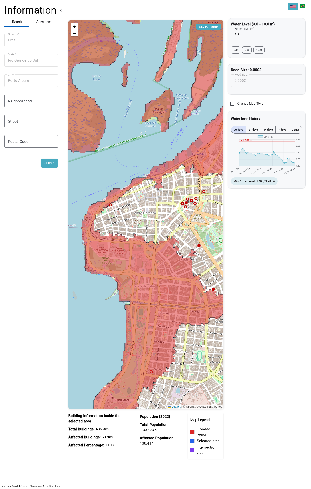

## 1. Resumo

Este relatório cumpre a Fase 1 do projeto: descreve a ferramenta atual do INCT SiMAI, perfila o arquivo `data.json` fornecido, cataloga as bases de dados sobre enchentes no Rio Grande do Sul que a equipe verificou e justifica a escolha das bases e da pergunta da Tela 2.

**Escolha para a Tela 2.** A Tela 2 vai responder à pergunta: *"Os níveis da simulação já aconteceram de verdade? Com que frequência o Guaíba passa da cota de inundação, e o que a simulação do INCT diz sobre os níveis que a cidade já viveu, inclusive em maio de 2024?"* Para isso usaremos, em ordem de prioridade:

1. **Telemetria da ANA** (estações Cais Mauá C6 e Usina do Gasômetro), coletada por código via a API pública da Agência Nacional de Águas. Série de 15 em 15 minutos desde julho de 2014.
2. **Série de cotas máximas anuais 1899–2024** do Estudo Hidrológico do DMAE (Rhama Analysis, junho de 2026), extraída por código do PDF.
3. **Banco de dados das cheias de maio de 2024** da UFRGS (Zenodo, CC-BY 4.0), em especial a mancha observada por satélite em 06/05/2024 e a tabela de área diretamente afetada por município.
4. **Atlas Digital de Desastres no Brasil** (Sedec/MIDR), base 1991–2025 em CSV, para o contexto dos municípios do RS em 2024.

Todas as bases foram acessadas e testadas em 28/10/2026; as URLs, formatos e licenças estão na seção 5 e no Anexo A. Os dados brutos de todas as fontes foram baixados em 29/10/2026 pelo script `scripts/baixar_anexos_fase1.py` para `relatorios/anexos/` (Anexo B).

## 2. A ferramenta atual do INCT

Endereço: <http://vhlab.com.br/INCT/floods/> (link do enunciado). Acessada em 28/10/2026 com navegador headless; captura completa em `figuras/dashboard_inct_2026-10-28.png`.

{width=100%}

### 2.1 O que a ferramenta mostra

- Um mapa Leaflet sobre OpenStreetMap com a **mancha de inundação** (vermelho) para o nível escolhido, centrado no Centro Histórico.
- Um campo "Water Level (m)" de 3,0 a 10,0 m com três atalhos (3.0, 5.3, 10.0) e um parâmetro "Road Size" sem explicação.
- Indicadores para a área selecionada: total de prédios, prédios afetados, porcentagem, população total (2022) e população afetada. A 5,3 m os valores exibidos são 486.389 prédios, 53.989 afetados (11,1 %) e 138.414 pessoas afetadas de 1.332.845.
- Um painel "Water level history" com o nível do Guaíba nos últimos 2 a 30 dias e a linha "Limit 3.00 m".
- Busca por país, estado, cidade, bairro, rua e CEP; aba "Amenities"; seleção de grade no mapa; botão de idioma (inglês padrão, português disponível).
- Rodapé: "Data from Coastal Climate Change and Open Street Maps".

### 2.2 O que funciona

- A mancha por nível é visualmente clara e reage aos atalhos de nível.
- O histórico do nível é um recurso útil: a aplicação lê a estação **87450004 (Cais Mauá C6)** da ANA, campo `Cota_Adotada`, o que mostra que ligar a simulação ao nível real é viável.
- Os totais da cidade a 5,3 m **batem exatamente** com o que calculamos a partir do `data.json` (53.989 prédios, 138.414 pessoas, 1.332.845 habitantes), ou seja, o JSON entregue é a mesma base da ferramenta.

### 2.3 O que atrapalha (observações para o relatório do dashboard)

| Problema observado | Evidência |
|----------------------------------------------------|------------------|
| **Lentidão.** Só o HTML inicial levou 12,4 s para responder; o pacote JavaScript principal tem 1,0 MB e há 10 pacotes adicionais. | `curl` em 28/10/2026 23:38 |
| **Dependência de um servidor interno.** O código aponta para `http://vhlab.lad.pucrs.br:5002` (rotas `/api/map-data`, `/api/get-building-data`, `/api/address-data`, `/api/serie-telemetrica`). Esse servidor não respondeu de fora da PUCRS no nosso teste, o que explica a instabilidade relatada. | `main-NLG32SEF.js` |
| **Não responde "quais bairros"**. Os indicadores valem para a área selecionada no mapa, não há tabela, ranking nem gráfico por bairro; o usuário precisa desenhar uma grade ou buscar um bairro de cada vez. | captura |
| **Nível só por caixa de texto.** Não há controle deslizante; os três atalhos pulam de 3,0 para 5,3 e 10,0 m. | captura |
| **Interface em inglês por padrão** e termos sem explicação ("Road Size: 0.0002", "Select grid", "Intersection area"). | captura |
| **Sem aviso de limitações** (estimativa de simulação, distribuição uniforme da população, prédios não residenciais). | captura |
| **Sem fonte com link nem data de coleta** para os dados; apenas o rodapé genérico. | captura |
| **Mapa ocupa quase toda a tela**; os números ficam abaixo da dobra, e nada é visível em celular sem rolar. | captura 1400×2200 |
| **Cota de inundação fixa em 3,00 m** no gráfico, mas a estação Cais Mauá C6 ficou fora do ar de 03/05/2024 a junho de 2025 (ver seção 5.1); a ferramenta não indica isso. | ANA, DMAE 2026 |

## 3. Os dados do INCT (`data.json`)

Perfil feito em 28/10/2026 com Python puro, sem limpeza ainda (a limpeza é a Fase 2).

| Item | Valor |
|------------------------------|----------------------------------------|
| Níveis | 71, de `3_0m` a `10_0m`, passo 0,1 m, sem faltas |
| Bairros por nível | 94 em todos os níveis, mesmo conjunto de nomes |
| Linhas em formato longo | 6.674 × 7 (como o enunciado prevê) |
| Campos | `affected_buildings`, `total_buildings`, `percentage`, `population`, `affected_population` |
| População total (soma dos 94 bairros) | 1.332.845 |
| A 5,3 m | 53.989 prédios afetados, 138.414 pessoas, 36 bairros atingidos |
| A 10,0 m | 101.211 prédios afetados, 274.993 pessoas, 54 bairros atingidos |

Primeiro sinal de inconsistência já visível: no nível `5_3m` os bairros estão em ordem diferente dos demais níveis. Outras verificações (monotonicidade, coerência de `percentage` e `affected_population`) ficam para a Fase 2.

**Nomes de bairros.** Os 94 nomes do INCT coincidem com os 94 bairros oficiais (LC 12.112/16) usados pelo ObservaPOA e pelo IBGE, com duas grafias divergentes que precisarão de tabela de equivalência: `Passo D'Areia` (INCT) ↔ `Passo da Areia` (ObservaPOA, IBGE) e `Menino Deus` (INCT) ↔ `Menino-Deus` (IBGE).

## 4. Como ler a seção de bases

Para cada base registramos: origem, conteúdo, recorte espacial e temporal, formato, forma de coleta, licença, ligação com os dados do INCT e o que verificamos em 28/10/2026. As bases 5.1 a 5.4 são as escolhidas para a Tela 2; 5.5 a 5.8 são complementares (malha, população, equipamentos) e 5.9 lista o que foi avaliado e descartado.

## 5. Bases levantadas

### 5.1 Telemetria do nível do Guaíba — ANA (Rede Hidrometeorológica Nacional) ★ escolhida

- **Origem:** Agência Nacional de Águas e Saneamento Básico (ANA). Estações operadas pela SEMA-RS (Cais Mauá) e pelo SGB-CPRM (Gasômetro).
- **Conteúdo:** nível do rio em centímetros (campo `Nivel`), vazão e chuva, a cada 15 minutos. Duas estações em Porto Alegre, ambas no rio Guaíba (código do rio 87200000):
  - **87450004 — CAIS MAUÁ C6** (lat −30,0211, lon −51,2211). Dados de 27/07/2014 até 02/05/2024 23:45 (último valor 3,69 m); a estação sofreu pane durante a cheia e voltou a operar em junho de 2025 segundo o DMAE. Cotas oficiais: alerta 2,55 m, inundação 3,00 m.
  - **87450020 — USINA DO GASÔMETRO** (lat −30,0347, lon −51,2419). Estação emergencial instalada em 03/05/2024, dados contínuos desde então. Cotas definidas pelo Estado em 28/05/2024: alerta 3,15 m, inundação 3,60 m.
- **Recorte:** Porto Alegre; 2014 → hoje (com a troca de estação em 03/05/2024).
- **Formato e coleta:** XML (DataSet .NET) pelo serviço público `https://telemetriaws1.ana.gov.br/ServiceANA.asmx/DadosHidrometeorologicos?codEstacao=&dataInicio=&dataFim=` (sem autenticação; testado: 2015 inteiro retornou 32.571 registros para a 87450004). Metadados das estações em `ListaEstacoesTelemetricas`. Existe também o HidroWebService novo (`https://www.ana.gov.br/hidrowebservice/`), que exige cadastro e token OAuth; usaremos o serviço antigo, que a própria ferramenta do INCT também consome.
- **Licença:** dados públicos da ANA (Lei de Acesso à Informação e Política de Dados Abertos do governo federal); citar "ANA/SEMA-RS/SGB".
- **Ligação com o INCT:** o nível do Guaíba é exatamente o eixo do controle deslizante da Tela 1. Cada leitura real pode ser projetada na curva "população afetada × nível" da simulação.
- **Atenção (limitação a documentar):** as duas estações têm referências altimétricas diferentes. A 87450020 registrou máximo de 4,17 m em maio de 2024, enquanto a cota oficial do recorde, 5,35 m, é referida ao Cais Mauá (datum Imbituba). Não se pode simplesmente emendar as séries; a Tela 2 vai mostrá-las separadas, cada uma com sua cota de inundação, ou aplicar o deslocamento documentado pelo DMAE.
- **Verificado em 28/10/2026:** sim. Séries completas das duas estações baixadas em 29/10/2026 para `anexos/02_ana_telemetria_nivel_guaiba/` (311.265 leituras da Cais Mauá C6, 83.806 da Gasômetro).
- **Qualidade da série bruta (para a Fase 2):** há leituras sem nível (cerca de 4 % na Cais Mauá), valores espúrios (3,90 m em 15/05/2017, quando a máxima anual foi 2,94 m; −0,19 m na Gasômetro em 25/11/2024) e carimbos de data no futuro (até 01/12/2026). A limpeza precisa remover esses pontos antes de contar ultrapassagens da cota.

### 5.2 Cotas máximas anuais do Guaíba 1899–2024 — DMAE / Rhama Analysis ★ escolhida

- **Origem:** "Avaliação e Recuperação do Sistema de Proteção Contra Cheias de Porto Alegre — P05 Parte I, Estudo Hidrológico", Rhama Analysis (resp. Carlos E. M. Tucci) para o DMAE, 24/06/2026. PDF de 78 páginas em <https://prefeitura.poa.br/sites/default/files/usu_doc/sites/dmae/P05%20-%20Estudo%20Hidrologico_SPCC_Parte%20I_R01.pdf>.
- **Conteúdo:** Tabela 2 com a cota máxima de cada ano de 1899 a 2024 (série não homogênea, medida em quatro pontos do Cais Mauá), Tabela 4 com a série homogeneizada para a Doca 4 (datum Imbituba), tempos de retorno (Gumbel e GEV), níveis diários das cheias de 1941 e 2024, e a lista de estações da ANA com dados de 2024. Valores-chave: 1941 = 4,75 m; 1967 = 3,13 m; 2015 = 2,94 m; 2023 = 3,46 m; 2024 = 5,35 m.
- **Recorte:** Porto Alegre, Cais Mauá; anual, 1899–2024.
- **Formato e coleta:** PDF; extração por código com `pdftotext` e expressões regulares (já testada: 126 anos extraídos, PDF e tabelas em `anexos/03_dmae_rhama_estudo_hidrologico_2026/`).
- **Licença:** documento público da Prefeitura de Porto Alegre; citar DMAE/Rhama (2026) e as fontes originais que a tabela indica (Brasil, 1968; ANA, 2024).
- **Ligação com o INCT:** permite marcar na curva da Tela 1 todos os anos em que o rio passou de 3,0 m e responder "quantas pessoas a simulação indicaria para a cheia de 1941, 1967, 2015, 2023 e 2024". Também valida o recorde de 5,35 m usado na Tela 1.
- **Limitação:** a Tabela 2 é uma série não homogênea (letras (a) a (h) identificam a régua). A Tabela 4, homogeneizada para a Doca 4 no datum Imbituba, dá valores menores para os mesmos anos (1941 = 4,41 m; 2023 = 3,10 m; 2024 = 4,90 m). O dashboard vai usar os valores "oficiais" da Tabela 2, que são os divulgados (5,35 m em 2024), e avisar que a referência altimétrica muda conforme a fonte.

### 5.3 Banco de dados das cheias na Região Hidrográfica do Lago Guaíba, maio de 2024 — UFRGS (Zenodo) ★ escolhida

- **Origem:** esforço voluntário de pesquisadores da UFRGS (Possantti, I. et al.). DOI conceitual 10.5281/zenodo.11164049; versão mais recente v1.2 de 05/08/2024 em <https://zenodo.org/records/13227745>.
- **Conteúdo:** geopackage `cheias_rhguaiba_2024_db_v12.gpkg` (196 MB) com camadas catalogadas em `..._glossario.csv` (anexo). Para Porto Alegre: `poa_admin_bairros`, manchas hidrostáticas para 1941 (475 cm), 1967 (313 cm), 2015 (294 cm), set/2023 (318 cm), nov/2023 (346 cm), 2024 (530 cm) e simuladas de 500 a 700 cm, `poa_pontos_nivel` (observações de campo), unidades de saúde e assistência social, diques, comportas e casas de bombas. Para a região: mancha de água observada por Sentinel-2 em 06/05/2024 (validada), severidade simulada em HEC-RAS, bacia. CSV `analise_ada_rhguaiba_municipios_10052024.csv` com 139 municípios: pessoas e domicílios afetados (Porto Alegre: 151.141 pessoas, 11,3 %; 85.368 domicílios), vias, área urbana afetada, escolas e unidades de saúde atingidas. CSV de abrigos (`rs_crise_abrigos_24052024_20h.csv`, fonte SOS RS, com capacidade e pessoas abrigadas).
- **Recorte:** Região Hidrográfica do Lago Guaíba, com camadas específicas de Porto Alegre; evento de maio de 2024 (06/05 e 08/05) e manchas históricas.
- **Formato e coleta:** GPKG e CSV; download automatizado pela API do Zenodo (`https://zenodo.org/api/records/13227745/files/<arquivo>/content`), leitura com geopandas/pyogrio por camada.
- **Licença:** Creative Commons Attribution 4.0 (CC-BY 4.0).
- **Ligação com o INCT:** (a) cruzar a mancha observada de 06/05/2024 com a malha de bairros e comparar, bairro a bairro, a fração atingida com a `percentage` da simulação a 5,3 m; (b) comparar Porto Alegre com os outros municípios da região (pessoas afetadas em %); (c) as manchas hidrostáticas de 1941, 1967, 2015 e 2023 permitem a mesma comparação para os níveis históricos.
- **Limitações:** os autores avisam que é um esforço emergencial, ainda em andamento, com insumos de terceiros que devem ser validados; versões antigas (v0.1, v0.2) estão corrompidas; arquivo grande (guardar em `dados/originais/` e não repetir o download).

### 5.4 Atlas Digital de Desastres no Brasil — Sedec/MIDR ★ escolhida (contexto RS)

- **Origem:** Secretaria Nacional de Proteção e Defesa Civil (Sedec) do Ministério da Integração e do Desenvolvimento Regional, a partir dos registros municipais no S2iD. <https://atlasdigital.mdr.gov.br/>, página de downloads `paginas/downloads.xhtml`.
- **Conteúdo:** base completa 1991–2025, versão 1.1 de 06/08/2026. Uma linha por registro municipal de desastre (protocolo S2iD, município, código IBGE, data, COBRADE/tipologia), com danos humanos (mortos, feridos, enfermos, desabrigados, desalojados, desaparecidos, afetados), danos materiais (unidades habitacionais, instalações de saúde e ensino danificadas/destruídas) e prejuízos públicos e privados em R$ (originais e corrigidos pelo IGP-DI). Manual de tratamento e log de correções disponíveis.
- **Recorte:** Brasil, nível municipal, 1991–2025; filtraremos UF = RS e 2024.
- **Formato e coleta:** CSV separado por `;` em codificação Windows-1252 (86 MB) e XLSX; download direto por URL (`/arquivos/2026/BD_Atlas_1991_2025_v1.1_2026.08.06_Consolidado.csv`).
- **Licença:** não declarada na página; dados oficiais do governo federal (abertos por lei). Citar "Atlas Digital de Desastres no Brasil, Sedec/MIDR, v1.1 (2026)".
- **Ligação com o INCT:** responde "quais municípios do RS tiveram mais desalojados ou danos em 2024" e situa Porto Alegre entre eles; cruza com a simulação pela enchente de 2024.
- **Limitação:** registros autodeclarados pelos municípios; um mesmo evento pode gerar mais de um protocolo; somar com cuidado.

### 5.5 Malha oficial de bairros de Porto Alegre (LC 12.112/16) — DataPOA e ObservaPOA

- **Origem:** Prefeitura de Porto Alegre (SMAMUS). Portal DataPOA (CKAN): conjunto `bairros-lc-12-112-16`, shapefile `bairros_lc12112_16.zip` (3,5 MB, atualizado em 01/06/2023) e metadados; ObservaPOA: Bairros Oficiais em SHP e KML (Google Drive) na página <https://prefeitura.poa.br/smpg/observapoa/mapas>.
- **Conteúdo:** 94 polígonos de bairros, sistema SIRGAS 2000 / TM-POA.
- **Formato e coleta:** ZIP (SHP) e KML; via API CKAN `https://dadosabertos.poa.br/api/3/action/package_show?id=bairros-lc-12-112-16` (testada) e download por URL.
- **Licença:** Creative Commons Attribution (DataPOA).
- **Ligação com o INCT:** é a chave espacial para o mapa opcional da Tela 1 e para recortar manchas e equipamentos por bairro na Tela 2. Grafias a conciliar (seção 3).

### 5.6 População por bairro, Censo 2022 — ObservaPOA e IBGE

- **ObservaPOA:** `Pop_Bairro_Censo_2022.csv` e `.xlsx` (94 bairros, universo, limites de 2016), CSV em Latin-1 com `;` (anexo). Também setores censitários 2022 (SHP). Licença não declarada; fonte IBGE/Prefeitura.
- **IBGE, Agregados por Setores Censitários 2022 — recorte por bairro:** `https://ftp.ibge.gov.br/Censos/Censo_Demografico_2022/Agregados_por_Setores_Censitarios/Agregados_por_Bairro_csv/` com arquivos `basico` (domicílios, pessoas, média de moradores, área), `demografia`, `cor_ou_raca`, `alfabetizacao`, `caracteristicas_domicilio1/2/3`, `obitos`, `parentesco`, mais dicionário XLSX e malha com atributos. Testado: o arquivo básico tem 94 bairros de Porto Alegre (CD_MUN 4314902). A variável de rendimento por bairro ainda precisa ser confirmada no dicionário; se não existir, a alternativa é agregar setores censitários por bairro ou usar a renda do Censo 2010 do ObservaPOA.
- **Ligação com o INCT:** permite verificar o campo `population` do JSON (que diz vir do Censo 2022) e responder "os bairros mais expostos são os de menor renda?" (pergunta alternativa da Tela 2).
- **Licença:** dados públicos do IBGE (citar fonte).

### 5.7 Escolas e equipamentos — DataPOA (SIE) e OpenStreetMap

- **DataPOA, SIE — Sistema de Informações Educacionais (SMED):** `cadastro_escolas.csv` (207 KB, 01/01/2025) e `matriculas_escolas.csv` (01/10/2026), com dicionários em PDF; CC-BY; via API CKAN (`package_show?id=sie`). Cobre a rede municipal; endereços permitem atribuir bairro.
- **OpenStreetMap via Overpass API:** consulta testada em 28/10/2026 (`amenity=school` e `amenity=hospital` dentro de Porto Alegre) retornou 490 objetos. Licença ODbL (exige atribuição "© OpenStreetMap contributors"); coleta por código com `requests`, respeitando o limite de uso e um `User-Agent` identificado. Como `total_buildings` do INCT vem do OSM, essa é a base mais coerente para contar equipamentos em área alagada.
- **UFRGS/Zenodo (5.3)** também traz unidades de saúde e assistência social de Porto Alegre e escolas do INEP 2023 para o RS.
- **Ligação com o INCT:** "quantas escolas e unidades de saúde ficam em bairros com mais de X % de prédios afetados a cada nível" (pergunta alternativa da Tela 2).

### 5.8 Página "Dados da Inundação 2024" — ObservaPOA/SMAMUS

- <https://prefeitura.poa.br/smpae/observapoa/dados-da-inundacao-2024> (atualizada em 02/08/2024). A notícia de 24/05/2024 anuncia dados de endereços do CNEFE (IBGE) por bairro atingido total ou parcialmente. Em 28/10/2026 a página é apenas uma capa sem arquivos para download; os dados devem estar no portal ObservaPOA ou no site de indicadores (`portoalegreemanalise.procempa.com.br`). Fica registrada como base a confirmar na Fase 2; se os arquivos aparecerem, substituem o geoprocessamento da mancha da 5.3 por uma tabela oficial por bairro.

### 5.9 Avaliadas e não escolhidas

| Base | Motivo |
|------------------------|--------------------------------------|
| HidroWebService novo da ANA (`ana.gov.br/hidrowebservice`) | Exige cadastro e token OAuth; o serviço antigo cobre a mesma série sem autenticação. |
| Painel "Desastres Naturais no RS" (SPGG/Defesa Civil, `desastresnaturais.rs.gov.br`, hospedado no IEDE-RS) | Visualização ArcGIS Experience Builder, 2003–2022, sem download; o Atlas Digital traz os mesmos registros S2iD em CSV até 2025. |
| S2iD (`s2id.mi.gov.br`) | Sem exportação aberta direta; é a fonte primária do Atlas Digital. |
| Boletins da Defesa Civil RS de maio de 2024 | Totais estaduais em PDF/notícias, números divergem entre fontes e horários; úteis só como citação. |
| Serviço WMS do INPE (`data.inpe.br/big/geoserver/charter/wms`) | GetCapabilities respondeu sem listar camadas no teste; mancha consolidada já coberta pela base da UFRGS. |
| `nivelguaiba.com.br` e MetSul | Não oficiais; reaproveitam a telemetria da ANA. |
| INMET (chuva histórica) | O portal não respondeu no teste e a chuva local não explica o nível do Guaíba, que depende das bacias a montante. |
| Dados pessoais de abrigados ou notícias com nomes | Vedados pelos cuidados éticos do enunciado. |

## 6. Escolha justificada e pergunta da Tela 2

**Pergunta principal:** *Os níveis simulados já aconteceram? Com que frequência o Guaíba passou da cota de inundação, e o que a simulação do INCT indica para as cheias reais de 1941, 1967, 2015, 2023 e 2024?*

**Pergunta secundária (mesmas bases):** *A simulação a 5,3 m bate com a mancha observada em maio de 2024, bairro a bairro, e como Porto Alegre se compara aos outros municípios do RS?*

**Por que essas bases:**

1. **Cumprem o requisito de coleta por código**: a telemetria da ANA é uma API; o Zenodo e o Atlas são downloads automatizados por URL; o DataPOA tem API CKAN.
2. **Conversam diretamente com a Tela 1 pelo nível do Guaíba**: cada leitura real ou máxima anual cai sobre o eixo do controle deslizante, e a curva de população afetada pode ser anotada com os picos históricos. É a ligação mais forte e mais fácil de explicar à defesa civil, à imprensa e aos moradores.
3. **Fecham o ciclo com a enchente de 2024**: a mancha observada e a tabela de área afetada permitem testar a simulação contra o que aconteceu, o que é a devolutiva mais útil para o INCT.
4. **Licenças claras** (CC-BY 4.0, CC-BY, dados públicos federais) e fontes oficiais ou acadêmicas, citáveis com link e data.
5. **Risco controlado**: a ANA, o Atlas e os CSVs do Zenodo são leves. O único arquivo pesado é o geopackage de 196 MB, que tem um plano B (tabela oficial por bairro do ObservaPOA, 5.8) e um plano C (perfil socioeconômico por bairro com IBGE 2022, 5.6).

**Visualizações previstas para a Tela 2** (mínimo 3, com 1 filtro e 1 ligação com a Tela 1):

- Série do nível do Guaíba (ANA) com as cotas de alerta e inundação de cada estação; filtro de período e de estação.
- Cotas máximas anuais 1899–2024 (DMAE) com destaque nos anos acima de 3,0 m e contagem de ultrapassagens por década.
- Curva "população afetada × nível" da Tela 1 anotada com os picos históricos (ligação com a Tela 1).
- Comparação por bairro entre a simulação a 5,3 m e a mancha observada em 06/05/2024 (Zenodo), e ranking dos municípios do RS em 2024 (Atlas/ADA) com Porto Alegre destacada.

## 7. Próximos passos (Fase 2, até 09/11)

1. `scripts/coleta_ana.py`: baixar 2014–hoje das estações 87450004 e 87450020 em blocos anuais, salvar XML bruto em `dados/originais/ana/` e consolidar em CSV.
2. `scripts/coleta_zenodo.py`: baixar o glossário, os CSVs e o geopackage v1.2 (uma vez), recortar as camadas de Porto Alegre.
3. `scripts/coleta_atlas.py`: baixar o CSV do Atlas, filtrar RS/2024.
4. `scripts/coleta_datapoa.py`: malha de bairros e cadastro de escolas via CKAN; tabela de equivalência de nomes de bairros.
5. Extrair a Tabela 2 e a Tabela 4 do estudo do DMAE por código e documentar a diferença de referência altimétrica entre as estações.
6. Limpeza do `data.json` e relatório `limpeza_dados.pdf`.

## 8. Registro de uso de IA

Este relatório e a verificação das fontes foram feitos em 28/10/2026 com apoio do Claude Code (Anthropic), usado para: baixar e inspecionar a ferramenta do INCT, perfilar o `data.json`, consultar as APIs e portais listados, extrair a tabela do PDF do DMAE e redigir o texto. Todas as URLs e números foram conferidos por chamadas diretas aos serviços na mesma data; a equipe revisou o conteúdo e é responsável por ele. O uso será registrado também no fórum do Moodle, como pede o enunciado.

## Anexo A — Links, formatos e data de coleta

| # | Base | URL | Formato | Licença | Coleta |
|--|-----------------|---------------------------------------|---------|------------|---------|
| 1 | Ferramenta INCT SiMAI "Flood" | http://vhlab.com.br/INCT/floods/ | web (Angular) | — | 28/10/2026 |
| 2 | ANA telemetria, estação 87450004 e 87450020 | https://telemetriaws1.ana.gov.br/ServiceANA.asmx/DadosHidrometeorologicos | XML | dados públicos ANA | 28/10/2026 |
| 3 | ANA lista de estações | https://telemetriaws1.ana.gov.br/ServiceANA.asmx/ListaEstacoesTelemetricas | XML | dados públicos ANA | 28/10/2026 |
| 4 | Cotas de inundação do Gasômetro (Estado RS, 28/05/2024) | https://www.estado.rs.gov.br/estado-atualiza-cota-de-inundacao-do-guaiba-na-usina-do-gasometro | notícia | — | 28/10/2026 |
| 5 | DMAE/Rhama, Estudo Hidrológico P05 (24/06/2026) | https://prefeitura.poa.br/sites/default/files/usu_doc/sites/dmae/P05%20-%20Estudo%20Hidrologico_SPCC_Parte%20I_R01.pdf | PDF | documento público | 28/10/2026 |
| 6 | UFRGS, Banco de dados das cheias RH Guaíba v1.2 | https://zenodo.org/records/13227745 (DOI 10.5281/zenodo.11164049) | GPKG, CSV | CC-BY 4.0 | 28/10/2026 |
| 7 | Atlas Digital de Desastres no Brasil v1.1 | https://atlasdigital.mdr.gov.br/paginas/downloads.xhtml | CSV, XLSX, PDF | não declarada (dado público) | 28/10/2026 |
| 8 | DataPOA, bairros LC 12.112/16 | https://dadosabertos.poa.br/dataset/bairros-lc-12-112-16 | SHP (ZIP) | CC-BY | 28/10/2026 |
| 9 | DataPOA, SIE cadastro de escolas | https://dadosabertos.poa.br/dataset/sie | CSV | CC-BY | 28/10/2026 |
| 10 | ObservaPOA, mapas e Censo 2022 por bairro | https://prefeitura.poa.br/smpg/observapoa/mapas | CSV, XLSX, SHP, KML | não declarada | 28/10/2026 |
| 11 | ObservaPOA, Dados da Inundação 2024 | https://prefeitura.poa.br/smpae/observapoa/dados-da-inundacao-2024 | página | — | 28/10/2026 |
| 12 | IBGE, Censo 2022 agregados por bairro | https://ftp.ibge.gov.br/Censos/Censo_Demografico_2022/Agregados_por_Setores_Censitarios/Agregados_por_Bairro_csv/ | CSV (ZIP) | dados públicos IBGE | 28/10/2026 |
| 13 | OpenStreetMap, Overpass API | https://overpass-api.de/api/interpreter | JSON | ODbL | 28/10/2026 |
| 14 | Jornal do Comércio, recorde de 5,35 m (jun/2024) | https://www.jornaldocomercio.com/geral/2024/06/1157183-nivel-do-guaiba-fica-abaixo-da-cota-de-inundacao-pela-1-vez-em-um-mes.html | notícia | — | enunciado |

## Anexo B — Dados brutos baixados em `relatorios/anexos/`

Baixados em 29/10/2026 por `scripts/baixar_anexos_fase1.py` (só biblioteca padrão do Python; reexecutável, pula o que já existe). O arquivo `anexos/README.md`, gerado pelo script, lista cada arquivo com descrição, fonte, URL, data e tamanho.

| Pasta | Conteúdo |
|----------------------|------------------------------------|
| `01_inct_simai_ferramenta_atual/` | Snapshot do HTML e do JS principal da ferramenta Flood |
| `02_ana_telemetria_nivel_guaiba/` | Lista de estações da ANA e séries de 15 min das estações 87450004 (2014–2026) e 87450020 (2024–2026), em CSV |
| `03_dmae_rhama_estudo_hidrologico_2026/` | PDF do Estudo Hidrológico P05, texto extraído e Tabelas 2 e 4 em CSV |
| `04_ufrgs_zenodo_cheias_rhguaiba_2024/` | Glossários, abrigos, área afetada por município, metadados e insumos pequenos (escolas INEP, barragens, deslizamentos). O geopackage v1.2 (196 MB) fica fora do git |
| `05_atlas_digital_desastres_sedec_mdr/` | Extrato RS/2024 (736 registros), manual e log de correções. A base completa 1991–2025 (CSV 86 MB, XLSX 71 MB) fica fora do git |
| `06_datapoa_prefeitura_poa/` | Malha de bairros LC 12.112/16 (SHP) com metadados; cadastro e matrículas de escolas (SIE) com dicionários |
| `07_observapoa_prefeitura_poa/` | População por bairro Censo 2022 (CSV/XLSX), bairros oficiais (SHP/KML), setores censitários 2022 (SHP) |
| `08_ibge_censo2022_agregados_por_bairro/` | Todos os arquivos de agregados por bairro (Brasil), dicionário, malha de bairros do RS com atributos e extrato de Porto Alegre |
| `09_openstreetmap_overpass/` | Escolas, unidades de saúde e equipamentos sociais/emergência de Porto Alegre (JSON) e a consulta usada |

Os três arquivos grandes (geopackage da UFRGS e base completa do Atlas) estão em `anexos/.gitignore` e só são baixados com `python3 scripts/baixar_anexos_fase1.py --grandes`, para não estourar o limite de 100 MB por arquivo do GitHub. Insumos do Zenodo acima de 100 MB (CNEFE, edificações Google, base cartográfica, MDE) não foram baixados; as URLs estão em `04_.../NAO_BAIXADOS.txt`.
